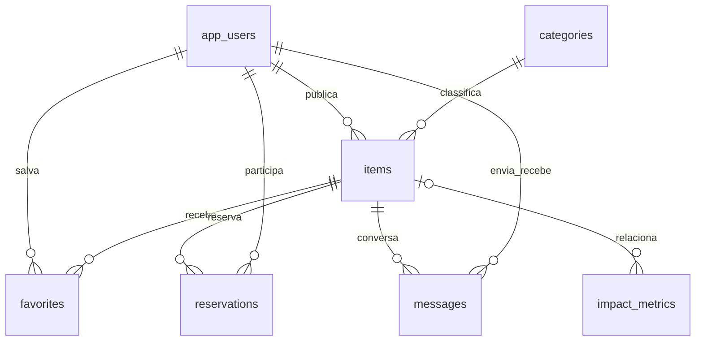

# Banco SQL

PostgreSQL 16; Spring Data JPA nas entidades de usuários, categorias, itens e mensagens, JdbcTemplate parametrizado nas operações de engajamento. Flyway aplica `src/main/resources/db/migration/V1...V3` antes de o Hibernate validar o schema. Não rode esses arquivos manualmente depois do Flyway.

- `app_users`: email único, senha BCrypt e papel de acesso.
- `categories`: cinco categorias iniciais; não sao anúncios ficticios.
- `items`: proprietário, categoria, descrição, modalidade, estado, galeria, localização e identificador de quem reservou.
- `favorites`: par usuário/item único, persistente e privado por conta.
- `reservations`: histórico; índice parcial garante no máximo uma reserva ativa por item. A transação trava o item antes de editar/reservar/cancelar/concluir.
- `messages`: remetente, destinatario, item e conteudo; endpoints limitam cada conversa aos participantes.
- `impact_metrics`: tabela legada de indicadores, preservada. A interface usa contagens reais de anúncios e estados; não estima impacto ambiental nem preenche essa tabela com numeros ficticios.

Estados do item: AVAILABLE -> RESERVED -> FINISHED, com cancelamento RESERVED -> AVAILABLE. Somente o proprietário conclui/remove; proprietário e solicitante podem cancelar uma reserva. Chaves estrangeiras e exclusao transacional mantem favoritos, reservas e mensagens coerentes ao remover um anúncio.

O perfil dev e um banco H2 independente. Bancos e fotos antigos sao preservados em disco; mudar o ambiente para PostgreSQL não importa dados H2 automaticamente. O deploy novo inicia uma comunidade vazia. O teste SQL usa somente `reuseplus_test`, separado da comunidade.

## Fotos SQL e leitura do chat (V4)

`uploaded_photos(name VARCHAR(64) PRIMARY KEY, content BYTEA NOT NULL)` armazena fotos com UPLOAD_STORAGE=database. Aplicação e CHECK SQL limitam cada foto a 8 MiB. O padrão permanece disk para instalações com volume. Fotos anteriores em disco continuam disponíveis, sem importação automática.

`messages.read_at`, já existente, é atualizado apenas pelo destinatário e interlocutor selecionado. POST `/api/messages/items/{itemId}/read?peerId={userId}` valida a relação anunciante/interessado; nunca marca a leitura por outra pessoa. Os GETs mantêm isolamento. O frontend agrupa por item e interlocutor.
